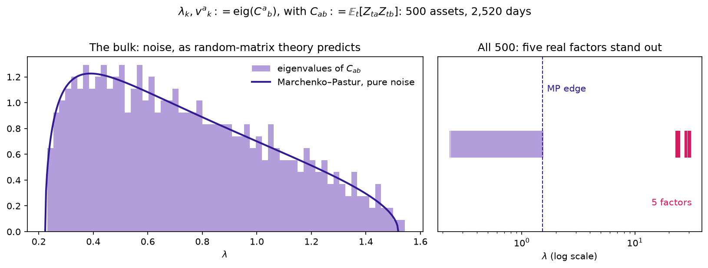

# Spaces and domains: one notation, from spacetime to a portfolio

*A design proposal. Status: implemented, with the four decisions taken as
recommended. The examples are written as implemented, which differs from the
proposal in two details: data brings its spaces with it, so none is made from it
with `\text{days}(R)`, and a name defined with `:=` has no superscript, so the
portfolio's variance \(\sigma^2_p\) became its volatility \(\sigma_p\). The user's
guide is [Beyond spacetime](../docs/spaces.md); this records why.*

## The idea

Index notation never needed spacetime. An index ranges over a **space**; a tensor
is an array whose axes range over spaces; Einstein summation is contraction; a
metric identifies a space with its dual. General Relativity, portfolio theory,
quantum mechanics and machine learning differ only in four things:

| | General Relativity | A portfolio | Two spins |
|---|---|---|---|
| What indices range over | 4 coordinates | 500 assets; 2,520 days | a qubit, twice |
| What components are | SymPy expressions | float64 | complex128 |
| The geometry of each space | a Lorentzian metric | none (the identity), or the covariance | the Hilbert inner product |
| Size | 256 symbolic components | millions of numbers | 16 numbers |

A **domain** is a choice of these four. The language stays the same, the compiler
and its IR stay the same, and RelativisticPy's job stays the same: read the
notation people already write, check it, and compute it with the best library for
the job: SymPy for exact symbolic work, NumPy and SciPy for numbers, scikit-learn
for statistical estimators.

## What it looks like

General Relativity is unchanged: spacetime is a space whose basis is the
coordinates, with the metric the line element gives it.

```latex
ds^2 = -\left(1 - \frac{2M}{r}\right) dt^2 + \ldots
R_{\mu\nu} = 0
```

A portfolio of 500 assets over ten years of trading days, with the returns bound to
`R_{ta}` from Python, which makes `t` range over the days and `a` over the assets:

```latex
\mu_a := \mathbb{E}_t[R_{ta}]                                   % expected returns
\Sigma_{ab} := \mathbb{E}_t[(R_{ta} - \mu_a)(R_{tb} - \mu_b)]   % covariance
\sigma_p := \sqrt{w^a \Sigma_{ab} w^b}                          % volatility of portfolio w
m^a := \frac{(\Sigma^{-1})^{ab} \mu_b}{1_c (\Sigma^{-1})^{cd} \mu_d}   % tangency portfolio
\lambda_k, v^a{}_k := \operatorname{eig}(C^a{}_b)               % spectrum of the correlations
```

Two spins with a Heisenberg coupling live on \(\mathcal{H} \otimes \mathcal{H}\)
simply by having two indices of each kind:

```latex
\mathcal{H} := \mathbb{C}^2
i, j, k, l \in \mathcal{H}
H^{ik}{}_{jl} := J (X^i{}_j X^k{}_l + Y^i{}_j Y^k{}_l + Z^i{}_j Z^k{}_l)
\operatorname{spec}(H)                                          % -3J, J, J, J
```

Least squares is the normal equations as they are written:

```latex
G_{kl} := X_{tk} X_{tl}
\beta^k := (G^{-1})^{kl} X_{tl} y_t
```

## The concepts

### Spaces

A space has a **size**, and may have:

- **labels** for its basis: the coordinates \((t, r, \theta, \phi)\), tickers,
  dates. Components are named by them, as `g_{tt}` already is.
- a **metric**. The default is the identity, as in Euclidean spaces. Spacetime gets
  its metric from the line element. Any symmetric positive definite tensor can be
  declared to be one, such as the covariance of returns.
- a **measure**, for expectations: uniform by default (\(1/T\) on each day), or
  weights \(p^t\).
- a **field**: \(\mathbb{R}\) or \(\mathbb{C}\).

Spaces are declared in the notation, `\mathcal{A} := \mathbb{R}^{500}` or
`\mathcal{H} := \mathbb{C}^2`, or come from data. Index labels are tied to spaces
by declaration, `a, b \in \mathcal{A}`, or by inference: binding data to `R_{ta}`
says that `t` ranges over days and `a` over assets. Product spaces need nothing:
a tensor with two qubit indices of each kind is an operator on
\(\mathcal{H} \otimes \mathcal{H}\).

### Positions, duals and metrics

Upper indices are vectors and lower ones covectors, in every domain. Weights
\(w^a\) are a vector; returns \(r_a\) are a covector, which pairs with weights
without any metric: \(r_p = w^a r_a\). A covariance \(\Sigma_{ab}\) is a bilinear
form on weights.

**The rule**: a summed index pairs one upper with one lower position. Two lower
indices may be summed only where the space's metric is the identity, because that
sum uses the identity as the metric. Euclidean spaces keep their usual,
position-free conventions; spacetime, and any space given a metric, keep
Einstein's.

Declaring the covariance to be the metric of the asset space turns portfolio
theory into geometry:

| Notation | With \(\Sigma\) as the metric |
|---|---|
| \(w_a = \Sigma_{ab} w^b\) | each asset's marginal contribution to risk |
| \(w^a w_a\) | the variance of the portfolio: the squared length of \(w\) |
| \(\mu^a = (\Sigma^{-1})^{ab} \mu_b\) | the direction of the Markowitz portfolios |

### Measures and expectations

`\mathbb{E}_t[\ldots]` binds the index \(t\) as a sum does. Inside it, every
factor shares \(t\) rather than summing it in pairs. A term without \(t\) is
constant in it, so \(R_{ta} - \mu_a\) is meaningful there and nowhere else.
Outside, the expectation is a contraction with the measure \(m^t\):
\(\mathbb{E}_t[X_{ta} Y_{tb}] = X_{ta} Y_{tb} m^t\), one contraction over three
tensors. The same idea covers `\sum_t`, `\operatorname{Var}_t` and
`\operatorname{Cov}_t`, weighted expectations \(\mathbb{E}_p\), and, later,
integrals with a continuous measure such as \(\sqrt{-g}\, d^4x\).

### Spectra and analysis

- `\operatorname{eig}(A^a{}_b)` is defined for maps: tensors with upper indices
  mapping to lower ones, such as \(A^a{}_b\) or \(H^{ik}{}_{jl}\) on a product
  space. It gives \(\lambda_k\) and \(v^a{}_k\), and with them a **new space**,
  the modes, over which \(k\) ranges.
- The eigenvalues of a bilinear form \(S_{ab}\) exist only relative to a metric:
  \(S_{ab} v^b = \lambda g_{ab} v^b\), the generalized eigenproblem. This is why
  the spectrum of a covariance depends on the metric chosen, and the notation
  makes the choice explicit rather than hidden.
- `\operatorname{spec}`, `\det`, `\operatorname{tr}` and norms `\|x\|`, plus SVD
  between two spaces (\(R_{ta} = U_{tk} s_k V_{ak}\): principal components),
  matrix functions (\(\exp\), \(\sqrt{\ }\), \(\log\)) and rank.
- The spectrum as a measure, the distribution of eigenvalues, compared with the
  laws of random matrices: see [Evidence](#evidence).

### Notation is the specification; the compiler chooses the algorithm

The compiler already plans: it checks indices before computing and contracts in a
cheap order. With numbers, planning matters more:

- \((\Sigma^{-1})^{ab}\mu_b\) is a linear solve, by Cholesky factorisation when
  \(\Sigma\) is symmetric positive definite, never an inverse;
- an expectation is fused into the contraction around it;
- contractions are ordered by cost, as `numpy.einsum` paths are;
- the notation layer, `relativisticpy.abstract`, can rearrange before any number
  flows. One example is solving the first-order conditions of a Lagrangian for
  \(w^a\), then evaluating the solution on data.

### Backends

The IR's operations, `Contract`, `Permute`, `Select`, `Add`, `Scale` and the
rest, do not care what components are. Kernels dispatch on them: SymPy arrays as
now, NumPy arrays with `numpy.einsum`. New operations for analysis: `Solve`,
`Eig`, `SVD`, `Reduce` (a measure), `Elementwise`.

- **SymPy**: exact and symbolic, for General Relativity and for derivations.
- **NumPy**: dense numerical tensors.
- **SciPy**: linear algebra (generalized and Hermitian eigenproblems, Cholesky),
  sparse spaces (`eigsh` for the top of a spectrum), optimisation.
- **scikit-learn**: estimators as functions, such as Ledoit–Wolf shrinkage of a
  covariance, PCA and regressions.
- **pandas**: labelled data in and out.
- **JAX**, later: gradients for optimisation, GPUs for scale.

The core keeps SymPy as its only dependency. `relativisticpy[numeric]` already
brings NumPy and SciPy; `relativisticpy[data]` would add pandas and scikit-learn.

### In Python

```python
wb = Workbook()
wb["R_{ta}"] = returns  # a DataFrame: its rows are days, its columns assets
wb.expr(r"\Sigma_{ab} := \mathbb{E}_t[(R_{ta} - \mu_a)(R_{tb} - \mu_b)]")
wb["Sigma"].to_pandas()  # labelled by ticker, both ways
```

The index labels in the key say which axis is which, and the frame's labels name
the basis of each space.

## Evidence

A throwaway prototype, about 500 lines outside the package, put this design to
the test. It uses RelativisticPy's own parser, with a small NumPy evaluator in
place of the compiler. Every result below matches a direct NumPy or SciPy
computation to rounding error, on synthetic returns for 500 assets over 2,520
days with five real factors:

| Notation | Checked against | Time |
|---|---|---|
| \(\mu_a := \mathbb{E}_t[R_{ta}]\), \(\Sigma_{ab} := \mathbb{E}_t[(R_{ta} - \mu_a)(R_{tb} - \mu_b)]\) | `np.cov` | 0.01 s |
| \(w^a \Sigma_{ab} w^b\) | `w @ Σ @ w` | |
| the tangency portfolio | `np.linalg.solve`; done as two Cholesky solves, no inverse | |
| \(w_a\), \(w^a w_a\), \(\mu^a\) with \(\Sigma\) as the metric | marginal risk, variance, Markowitz direction | |
| \(w_a w_a\) with \(\Sigma\) as the metric | refused: summed indices must pair up | |
| \(\lambda_k, v^a{}_k := \operatorname{eig}(C^a{}_b)\) | \(C v = \lambda v\); five eigenvalues above the Marchenko–Pastur edge | 0.01 s |
| \(\operatorname{spec}(H)\) for two spins | \(-3J, J, J, J\) | |
| \(\beta^k := (G^{-1})^{kl} X_{tl} y_t\) | `np.linalg.lstsq` | |



The bulk of the spectrum is noise, exactly as random-matrix theory predicts for
these proportions, and the five factors stand far outside it. Telling signal from
noise in a correlation matrix this way is everyday work in quantitative finance,
and here it is one line of notation.

The prototype also found what has to change, or be decided:

1. **Planning is not optional.** Averaging the product inside
   \(\mathbb{E}_t[\ldots]\) after forming it built a 2,520 × 500 × 500 array: 5 GB
   and 3.1 s. Fused into one contraction with the measure it took 0.01 s.
2. **Blackboard bold is dropped by the parser**: `\mathbb{R}` becomes `R`, the
   Ricci scalar, and `\mathbb{E}` becomes `E`. Spaces and expectations need it kept.
3. **`a, b \in \mathcal{A}`** splits at the comma into two statements. It should be
   one declaration.
4. **`y_t` is one name**, like `r_s`; only `y_{t}` is an index. Data notation
   writes `y_t`, so where `y` is a tensor `y_t` should index it, as `r_{s}`
   already depends on what `r` is.
5. **Elementwise products have no notation.** A diagonal \(D_{ij} = d_i
   \delta_{ij}\) is not a sum over \(i\), but Einstein's convention reads it as
   one. Options: `\operatorname{diag}(d)_{ij}`, the Hadamard product `\odot`, or
   both.
6. **Dirac notation**, \(\langle\psi|H|\psi\rangle\), reads `|H|` as an absolute
   value. It can come later.

## Plan

Each phase ends with every existing test passing: General Relativity never
regresses, because spacetime is simply the default space.

1. **Spaces in the type system, before any numbers.** `TensorType(indices, dim)`
   becomes `TensorType(indices, spaces)`: each axis knows its space and so its
   size. Index labels are bound to spaces, declared or inferred. Summation rules
   follow each space's metric. Parser fixes: blackboard bold, declarations with
   `\in`.
2. **Numerical components.** Kernels dispatch on SymPy or NumPy arrays; data is
   bound from NumPy and pandas; results are labelled tensors with `to_numpy` and
   `to_pandas`; expectations and measures, with the broadcasting rule. Every
   result is tested against NumPy.
3. **Linear algebra and spectra.** Inverses planned as solves; `eig` and its
   generalized form; SVD, determinants, traces, norms, matrix functions; new
   spaces from decompositions; elementwise products.
4. **Domains, as worked notebooks and a documentation page, "Beyond spacetime".**
   Portfolios (Markowitz, risk parity, factor models, the spectrum against
   Marchenko–Pastur, Ledoit–Wolf shrinkage from scikit-learn), two spins, graphs
   (the Laplacian and its Fiedler vector), regression.
5. **Scale.** Costed contraction planning, sparse spaces with iterative
   eigensolvers, streaming expectations over long series, and a JAX backend for
   gradients and GPUs. This is also the road to the numerical execution of the IR
   on the roadmap.

## Decisions to make

1. **Lower indices summed in Euclidean spaces**: allowed where the metric is the
   identity (recommended, and what the prototype does), or always forbidden.
2. **Elementwise products**: `\operatorname{diag}`, `\odot`, or both.
3. **Where data comes in**: from Python first (recommended), with loading files
   from the notation later.
4. **Dependencies**: numerical libraries as optional extras (recommended), or
   NumPy in the core.
